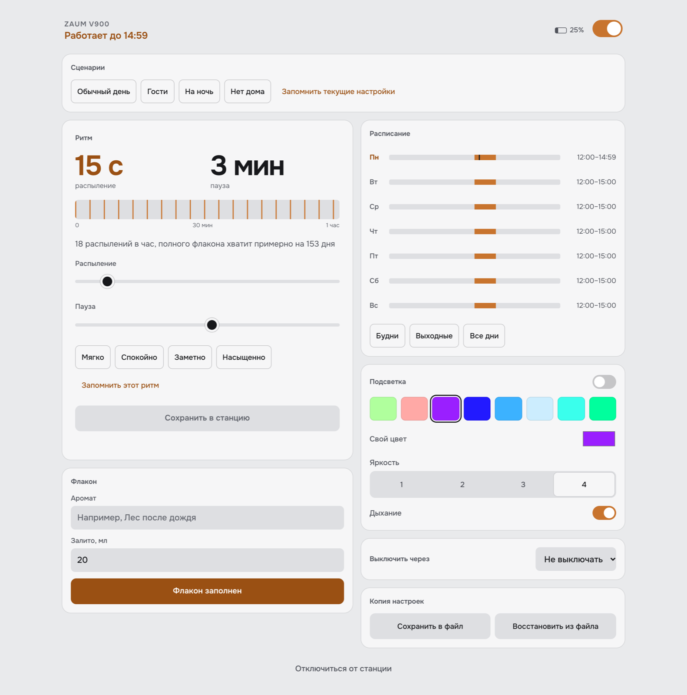

# Аромастанция

Удобное приложение для настройки аромастанции ZAUM V900 по Bluetooth. Работает без аккаунта и облака: настройки хранятся в самой станции и на твоём устройстве.

> Неофициальный проект. Он не связан с ZAUM и разработчиками Fragrant Pro. Проверен только на ZAUM V900, используй на свой риск.



## Как установить

| Устройство | Что сделать |
| --- | --- |
| Android | [Скачать APK](https://github.com/vitusha-rat/aroma-station/releases/latest/download/aroma-station.apk) и установить. На телефоне должен быть Chrome |
| Mac, Windows | Открыть [приложение](https://aroma-station-v900.netlify.app) в Chrome или Edge |
| iPhone | Открыть [приложение](https://aroma-station-v900.netlify.app) в бесплатном браузере [Bluefy](https://apps.apple.com/ru/app/bluefy-web-ble-browser/id1492822055) |

Safari не подходит: в нём нет Web Bluetooth.

Перед подключением удержи кнопку с солнцем 3 секунды, пока индикатор не станет фиолетовым, и закрой Fragrant Pro. Станция держит только одно подключение.

## Что умеет

- Ритм: распыление от 10 секунд до 2 минут, пауза от 15 секунд до часа.
- Расписание на каждый день недели, можно менять сразу несколько дней.
- Сценарии в одно нажатие: «Обычный день», «Гости», «На ночь», «Нет дома» и свои.
- Подсветка: любой цвет, 4 уровня яркости, дыхание.
- Таймер выключения на 1–24 часа.
- Учёт флакона: примерный остаток и на сколько дней хватит.
- Резервная копия настроек в файл.

## Разработка

Нужен Node.js 24 или новее.

```bash
npm install
npm run dev
npm test
npm run build
```

Android-версия собирается из `android/twa-manifest.json` с помощью [Bubblewrap](https://github.com/GoogleChromeLabs/bubblewrap) и открывает сайт в Chrome как отдельное приложение.

## Лицензия

[MIT](LICENSE)
